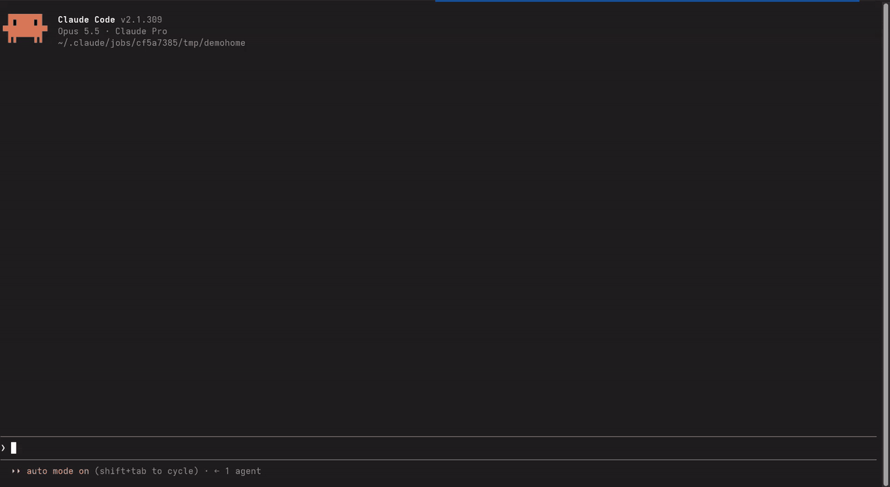
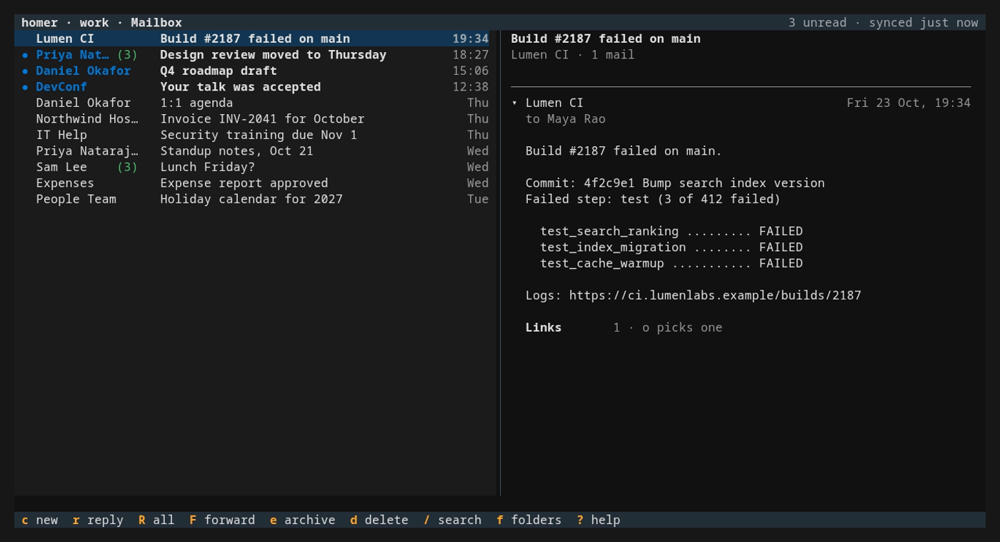
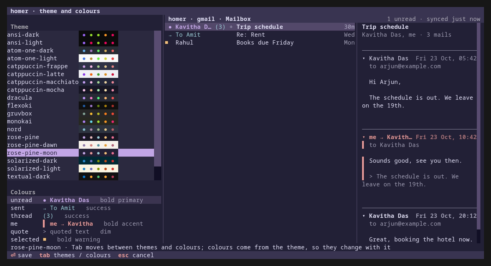

# Homer

Homer is for people who are tired of clicking through a mail app to write routine mail and keep their inboxes tidy. Its command line gives AI agents such as Claude Code, Codex and OpenCode access to your mailboxes, so they can do that work for you. When you want to go through mail yourself, the TUI lets you do it without leaving the terminal.

Homer handles Gmail, any IMAP/SMTP server, and institute or work mail on Microsoft 365 (Outlook).

```
$ homer list -a inst -n 3
      1 * 2026-10-11 06:52  Training & Placement          Internship drive: registrations open
      2 * 2026-10-10 23:53  Academic Office               Mid-sem timetable
      3   2026-10-10 20:46  Library                       Book due reminder
$ homer read -a inst 2 --save ~/Downloads
$ homer send -a gmail --to prof@uni.edu -s "Assignment 3" -b "Please find it attached." --attach a3.pdf
```

You can list, search and read mail, save attachments, send mail with attachments as plain text or HTML, reply in the same thread, forward mail with its attachments, save drafts, create folders, move messages, mark them read or unread, and manage the rules that sort new mail on the server (filters, in Gmail). All your accounts sit side by side and you pick one with `-a`.

Reading a message leaves it unread. Only `mark` changes that, so you (or an AI agent like Claude Code working for you) can look through mail without disturbing it. Every command takes and prints plain text, which is why agents can use it.

For going through mail yourself, run `homer` on its own to get a full-screen interface you drive from the keyboard. It's the one part of Homer where opening a message marks it read, the way a normal mail app does.

The command line uses only the Python standard library. The TUI uses Textual, which installs with Homer. Passwords and tokens are stored in your system keyring, not in files.

## Homer at work

These recordings run against a test server with made-up mail on two accounts, `work` and `personal`. [Development](#development) shows how to set it up.

### With an agent

Claude Code, using the example skill from [Using Homer from an agent](#using-homer-from-an-agent), is asked what's unread on `work`, then told to reply to Priya and archive the CI mail. It shows you the reply and waits for your OK before it sends:



### On the command line

Listing mail, reading a message and saving its attachment, replying in the same thread, and archiving a newsletter on the other account:


### In the TUI

Opening a conversation, writing a reply in `vi` and sending it, switching to the other account from the folder pane, and trying themes with `ctrl+t`. The recording skips most of the 10-second countdown before the reply goes out.


## Contents

- [Homer at work](#homer-at-work)
- [Requirements](#requirements)
- [Install](#install)
  - [Fedora](#fedora)
  - [Other distributions, with pipx](#other-distributions-with-pipx)
  - [Updating and removing a pipx install](#updating-and-removing-a-pipx-install)
- [Setup](#setup)
  - [Linking a Gmail account](#linking-a-gmail-account)
  - [Linking a Microsoft 365 account](#linking-a-microsoft-365-account)
    - [Option A: register your own app](#option-a-register-your-own-app)
    - [Option B: ask your IT department](#option-b-ask-your-it-department)
- [Usage](#usage)
  - [HTML mail](#html-mail)
  - [Rules and filters](#rules-and-filters)
- [Using Homer from an agent](#using-homer-from-an-agent)
- [TUI](#tui)
  - [Folders](#folders)
  - [Writing mail](#writing-mail)
  - [Colours](#colours)
  - [Planned for the TUI](#planned-for-the-tui)
- [Help & troubleshooting](#help--troubleshooting)
- [Privacy](#privacy)
- [Development](#development)
- [License](#license)

## Requirements

- Python 3.11+
- Linux with `secret-tool` (libsecret): Fedora `sudo dnf install libsecret`, Debian/Ubuntu `sudo apt install libsecret-tools`

## Install

### Fedora

```sh
sudo dnf copr enable rirzoo/homer
sudo dnf install homer
```

You need Fedora 43 or newer. dnf also installs libsecret and puts `homer` in `/usr/bin`, so there's no PATH to set up. Update with `sudo dnf upgrade homer` and remove it with `sudo dnf remove homer`. Removing the package leaves your passwords and tokens in the keyring, and `secret-tool clear service homer` deletes them.

### Other distributions, with pipx

On other distributions, and on Fedora 42 or older, Homer installs for your user only, into `~/.local/bin`. You don't need `sudo` for Homer itself, and since your config and keyring are per user anyway, there's no reason to install it system wide.

1. Install pipx, and git if you don't have it:

   ```sh
   sudo dnf install pipx git        # Fedora
   sudo apt install pipx git        # Debian / Ubuntu
   ```

2. Install Homer:

   ```sh
   pipx install git+https://github.com/rirzoo/homer.git
   ```

3. Put `~/.local/bin` on your PATH, then open a new terminal:

   ```sh
   pipx ensurepath
   ```

   To do it by hand instead, add this line to `~/.bashrc` (or `~/.zshrc` if you use zsh):

   ```sh
   export PATH="$HOME/.local/bin:$PATH"
   ```

4. Run `homer --help`. If you get `command not found`, your shell hasn't picked up the new PATH yet. Open a new terminal or run `source ~/.bashrc`.

You can use pip instead of pipx: `git clone https://github.com/rirzoo/homer.git && cd homer && pip install --user .`. Newer Ubuntu and Debian releases refuse that with an `externally-managed-environment` error, so stick with pipx there. To try Homer without installing it, run `python3 -m homer ...` from the cloned folder.

### Updating and removing a pipx install

```sh
pipx reinstall homer-mail          # get the latest version
pipx uninstall homer-mail          # remove homer
secret-tool clear service homer    # delete the passwords and tokens homer stored
```

Your config in `~/.config/homer/` stays until you delete it yourself.

## Setup

Homer doesn't create a config for you. Make the folder with `mkdir -p ~/.config/homer`, then create `~/.config/homer/accounts.toml` in any text editor (set `$HOMER_CONFIG` if you want it somewhere else). Each account gets a short name that you pass with `-a`:

```toml
default = "gmail"            # used when -a is omitted

[accounts.gmail]
email = "you@gmail.com"

[accounts.inst]
email = "you@institute.edu"
provider = "outlook"
tenant = "institute.edu"     # your org's domain or tenant ID
client_id = "00000000-0000-0000-0000-000000000000"
```

Then link each account with `homer login -a <name>` (details below) and check with `homer list -a <name>`.

### Linking a Gmail account

Gmail needs an app password, a 16-character password that only Homer uses:

1. Turn on 2-Step Verification: <https://myaccount.google.com/signinoptions/twosv>
2. Create an app password: <https://myaccount.google.com/apppasswords>
   (If it says *"The setting you are looking for is not available"*, 2-Step Verification is off, or the account uses Advanced Protection.)
3. In a normal terminal run `homer login -a gmail` and paste it. It goes straight into your keyring.

Other IMAP/SMTP providers (Fastmail, Zoho, a university mail server) work the same way once you add the server names:

```toml
[accounts.work]
email = "you@example.com"
imap = "imap.example.com"    # port 993, SSL      (imap_port to override)
smtp = "smtp.example.com"    # port 587, STARTTLS (smtp_port to override)
```

### Linking a Microsoft 365 account

Microsoft 365 doesn't accept passwords from third-party apps, so Homer signs in with OAuth through Microsoft Graph. For that you need a client ID, which tells Microsoft which app you're signing in through. There are two ways to get one.

#### Option A: register your own app

Many organisations let users do this.

1. Open <https://entra.microsoft.com>, go to *App registrations* and click *New registration*. Name it `homer`, keep "Accounts in this organizational directory only", and leave Redirect URI empty.
2. Under *Authentication*, open *Advanced settings*, set *Allow public client flows* to Yes, and save.
3. Under *API permissions*, click *Add a permission*, choose *Microsoft Graph*, then *Delegated*, and add `Mail.ReadWrite` and `Mail.Send`. Add `MailboxSettings.ReadWrite` as well if you want Homer to manage your rules.
4. On the *Overview* page, copy the Application (client) ID into `client_id` and the Directory (tenant) ID into `tenant`. Your mail domain also works for `tenant`.

#### Option B: ask your IT department

If you can't register apps, or sign-in says *"Need admin approval"*, your organisation decides which apps can access mail. Ask IT to approve your registration or to give you a client ID they allow, and please don't try to get around their policy. Some pre-approved apps only work with their preconfigured permissions. If IT gives you one of those, add:

```toml
scope = "https://graph.microsoft.com/.default offline_access"
```

Then sign in with:

```sh
homer login -a inst
```

It prints a code and a URL. Open the URL in any browser, enter the code, and sign in as usual (MFA included). Homer keeps a refresh token in your keyring and renews it automatically.

## Usage

```
homer accounts                                   list configured accounts
homer login   -a ACCT [--rules]                  link an account (--rules: also let Homer manage rules)
homer folders -a ACCT                            list folders
homer list    [-a ACCT] [-f FOLDER] [-n 20] [--unread] [--search QUERY]
homer read    ID [-a ACCT] [-f FOLDER] [--save DIR]
homer send    [-a ACCT] --to ADDR [--cc ADDR] [--bcc ADDR] -s SUBJECT [-b BODY] [--attach FILE ...] [--draft] [--html]
homer reply   ID [-a ACCT] [-f FOLDER] [-b BODY] [--all] [--attach FILE ...] [--draft] [--html]
homer forward ID --to ADDR [--cc ADDR] [--bcc ADDR] [-a ACCT] [-f FOLDER] [-b NOTE] [--attach FILE ...] [--draft] [--html] [--attached]
homer mkdir   FOLDER [-a ACCT]
homer move    ID... --to FOLDER [-a ACCT] [-f FROM]
homer mark    read|unread ID... [-a ACCT] [-f FOLDER]
homer rules   [-a ACCT]                          list rules (Gmail: filters) with their ids
homer rules add [-a ACCT] [--name NAME] [--from ADDR] [--to ADDR] [--subject TEXT] [--has TEXT]
                [--move FOLDER | --archive] [--read] [--delete] [--forward ADDR]
homer rules edit ID [-a ACCT] [same flags as add, plus --no-read and --no-delete]
homer rules rm ID... [-a ACCT]
homer daemon  enable|disable|status              background sync and notifications (a systemd user service)
homer         [-a ACCT]                          open the TUI (same as homer tui)
```

`--to`, `--cc`, `--bcc` and `--attach` can be repeated. Without `-b`, the body is read from stdin (`homer send ... < body.txt`). `--draft` saves to Drafts instead of sending.

`homer daemon enable` starts a background service that keeps your mail synced and stays signed in. It runs as a systemd user service (`homer.service`), so it starts when you log in and keeps going after you close the TUI. Every two minutes it fetches the folders of every account, so the TUI opens on current mail instead of syncing first. It also shows a desktop notification for new mail in the folders you choose: Mailbox, unless you pick others with `N` in the TUI's folder pane. Commands run through it too and skip connecting and logging in, which takes a Gmail `list` from about 2 seconds to about 1 and an Outlook one from about 1 second to 0.3. Without the service, commands connect on their own as before. A fresh service takes over every 45 minutes, after `homer login` and when Homer is updated. Only your user can reach it. `homer daemon status` says whether it's running and when it last synced, `homer daemon disable` stops and removes it, and `HOMER_DAEMON=0` keeps a command from using it.

`reply` answers the sender of message `ID` (add `--all` to include everyone else on it). It adds "Re:" to the subject, quotes the original under your text, and sets the headers mail apps use to keep the reply in the same conversation. Replying to a message you sent yourself goes to its original recipients, which is handy for a follow-up.

`forward` sends message `ID` to the `--to` addresses (and any `--cc`/`--bcc`), attachments included. The subject gets "Fwd:", and the original's From, Date, Subject, To and Cc lines sit above its text. Put a note on top with `-b` or on stdin, or leave it out: `homer forward 4321 --to friend@example.com`.

With `--attached` the original goes along as an `.eml` file instead, with its headers, formatting, images and attachments as they were, and your note is the whole body. Use it when the recipient needs the message exactly as you got it.

### HTML mail

Add `--html` to `send`, `reply` or `forward` when you want formatting or real links. Write the body as an HTML fragment; it doesn't need `<html>` or `<body>` tags. A quoted heredoc keeps quotes and `$` signs intact:

```sh
homer send --to friend@example.com -s "Notes" --html <<'EOF'
<p>Here are the <a href="https://example.com/notes">notes</a> from today.</p>
<p>See you on <b>Monday</b>.</p>
EOF
```

Homer also includes a plain-text version of the body for mail apps that don't show HTML. That version keeps the link text but drops the URL, so write out any address people need to see.

A reply or forward with `--html` quotes the original under your text, as HTML if the original was HTML and as text if it wasn't. Images embedded in an HTML original stay in place in the quote. Without `--html`, a forward sends those images as ordinary attachments.

Provider differences:

| | Gmail / IMAP | Outlook / Microsoft 365 |
|---|---|---|
| Message `ID` | UID shown by `list` (stable) | `#` from your most recent `list` on that account (or a full Graph message id) |
| `--search` | IMAP SEARCH: `'FROM "bob" SINCE 1-Oct-2026'` | Outlook search (KQL): `'from:bob subject:exam'` |
| Folder names | as `homer folders` shows them, e.g. `"[Gmail]/Sent Mail"`, `"[Gmail]/Bin"` | display name, or `inbox`, `sentitems`, `drafts`, `deleteditems`, `junkemail`, `archive` |
| Delete | `move ID --to "[Gmail]/Trash"` (`[Gmail]/Bin` in some regions) | `move ID --to deleteditems` |
| Limits | | max 4 MB per message incl. attachments; `mkdir` creates top-level folders |

Outlook numbers are reassigned on every `list`, so run `list` on the folder right before `read`/`move`/`mark`.

### Rules and filters

Rules run on the mail server and sort new mail as it arrives, whether or not Homer is running. Outlook calls them rules and Gmail calls them filters; Homer calls both rules.

```sh
homer rules -a inst                                         # list them with their ids
homer rules add -a inst --name Placements --from tpc@institute.edu --move Placements
homer rules add --from news@shop.example --archive --read
homer rules edit -a inst AQAAAGRpOkc= --from cell@institute.edu   # changes only the sender
homer rules rm -a inst AQAAAGRpOkc=
```

`--from`, `--to` and `--subject` match text anywhere in that field. `--has` looks in the body and subject on Outlook, and works like the Gmail search box on Gmail. Repeat a flag to match any of several values. When a rule has several conditions, all of them have to match.

The actions are `--move FOLDER`, `--archive`, `--read`, `--delete` and `--forward ADDR`. On Gmail, `--move` adds the label and takes the mail out of the inbox. `edit` changes only the flags you give it, and `--no-read` or `--no-delete` turn those actions off. A rule you made in Outlook or Gmail can have parts Homer doesn't know about, like categories or a size limit. `homer rules` marks such a rule with "(+ more)", and `edit` leaves those parts as they are.

Gmail filters have no names, and Gmail can't change one in place. On Gmail, `edit` adds the changed filter and then deletes the old one, so the filter gets a new id. A Gmail filter forwards to one address at most, and only to an address you've verified under *Settings → Forwarding*.

#### Setting up rules on Gmail

The app password only covers IMAP and SMTP, and IMAP can't see filters. Homer reaches them through the Gmail API, which needs an OAuth client from a Google Cloud project of your own. You set this up once:

1. Open <https://console.cloud.google.com>, create a project, and enable the *Gmail API* under *APIs & Services → Library*.
2. Open *Google Auth Platform*, choose *External*, and fill in an app name and your address. Under *Audience*, add your own address as a test user. The app starts in *Testing*, where it works straight away but your sign-in expires after 7 days. To keep it from expiring, click *Publish app*. Publishing asks for a homepage and a privacy policy, and you can give `https://github.com/rirzoo/homer` and `https://github.com/rirzoo/homer#privacy`. Google doesn't review the app either way, so the sign-in page warns that it's unverified. Click *Advanced* and continue, since the app is yours.
3. Under *Clients*, create a client of type *Desktop app*, and copy its ID and secret into the account (they're also in the JSON file you can download there). Google doesn't treat a desktop app's secret as confidential, so the config file is a fine place for it.

   ```toml
   [accounts.gmail]
   email = "you@gmail.com"
   client_id = "1234-abc.apps.googleusercontent.com"
   client_secret = "GOCSPX-..."
   ```

4. Run `homer login -a gmail --rules`. Homer opens Google's sign-in page in your browser and prints the link as well. Allow access to your filters and labels. Homer stores the token in your keyring next to the app password.

#### Setting up rules on Microsoft 365

Some accounts can manage rules with no extra setup, so try `homer rules -a inst` first. If it asks for `MailboxSettings.ReadWrite`, add that permission to your app as in step 3 of Option A and run `homer login -a inst --rules`.

## Using Homer from an agent

An agent uses Homer more reliably when a skill tells it when to reach for Homer and how. For Claude Code, save something like this as `~/.claude/skills/homer-mail/SKILL.md` and change the accounts to yours:

```markdown
---
name: homer-mail
description: Send, draft, reply to, read or search email with the homer CLI. Use whenever I ask to email someone, send a file, answer a mail or check my mail.
---

Use `homer` for all mail. `homer --help` and `homer <command> --help` list the options.

- Accounts: `gmail` (the default, personal mail) and `inst` (institute mail). Pick one with `-a`.
- Pass the body on stdin with a quoted heredoc (`<<'EOF'`) so quotes and `$` survive.
- Answer a mail with `homer reply ID`, not `send`, so it stays in the same thread.
- On Outlook accounts, IDs change with every `list`. Run `list` right before `read`, `move` or `mark`.
- Ask me before adding, changing or removing a rule with `homer rules`.
- Before sending, show me the recipient, subject and body and wait for my OK. If unsure, use `--draft`.
```

You can add your contacts' addresses and a signature to the same file. Codex and OpenCode read the same kind of instructions from `AGENTS.md`.

## TUI

`homer` opens your default account's Mailbox and `homer -a inst` opens another account; `homer tui` is the same thing. It's built on [Textual](https://textual.textualize.io), which installs along with Homer.

The screen has two panes: your mail on the left and the conversation under the cursor on the right. `f` opens a third pane on the left with your folders and your other accounts, and closes again once you pick one. A row is a whole conversation, so your replies sit next to the mail they answer (`T` switches to one row per mail). Below 100 columns you get one pane at a time.



Nothing waits on the server. Archive, delete, move and mark take effect on screen at once and sync in the background, and `u` undoes the last one. If the server refuses, the row comes back and the status line says why. Mail you've already seen is cached, so the list shows up the moment Homer starts.

| Key | In the list | In a conversation (`Enter`) |
|---|---|---|
| `j` `k`, arrows, `g` `G` | move | scroll (`space` and `b` page too) |
| `space` / `b` | scroll the preview | |
| `Enter` | open the conversation full width | expand or collapse the mail at the cursor |
| `n` / `p` | | next / previous mail |
| `c` | write a new mail | |
| `r` / `R` / `F` | reply / reply to all / forward | same |
| `e` / `d` | archive / delete (to Trash) | same |
| `m` / `M` | read or unread / move to a folder | same |
| `x` | select the row, so the next action covers every selected row | |
| `u` | undo | |
| `/` | search; `Tab` in the search bar switches between this folder and all folders | |
| `f` | folders and accounts | |
| `s` / `o` | | save attachments / open a link |
| `v` | open the mail in your browser, with its embedded images | same |
| `?` | every key for the window you're in | same |
| `q` | quit | back to the list |

Search takes one syntax on every account: `from:` `to:` `subject:` `is:unread` `is:read` `has:attachment` `before:2026-10-01` `after:2026-09-01` and plain words. Homer translates it for Gmail or Outlook. `+` loads 50 older conversations and `ctrl+r` syncs right away; Homer also syncs every two minutes on its own. With the background service on (`homer daemon enable`), the TUI opens on the mail the service fetched and doesn't wait for a sync.

### Folders

Every account has the same four folders: Mailbox (your inbox and your sent mail together), Drafts, Archive and Trash. You can add your own per account with `n` in the folder pane, and `E` picks which server folders or Gmail labels feed one. In that list `Space` or `Enter` ticks a folder and `s` saves. If you untick everything, Mailbox and Archive go back to their defaults, and a folder of your own stays but shows nothing. Archive is the catch-all: it shows whatever isn't in Mailbox or one of your own folders. If Archive or one of your own folders is fed by more than one server folder, `e` and `M` ask which one the mail goes into, and the one you picked last is at the top. `Esc` leaves the mail where it is. Moves to Mailbox always go to your inbox. Homer writes these choices to `~/.config/homer/folders.toml`. It never creates, renames or deletes anything on the server; use `homer mkdir` for that.

`R` renames one of your folders, or the account under the cursor. An account's new name is only what the TUI shows, so `-a` and `homer login` still take the name from your config. The names live in `~/.config/homer/tui.toml`.

`N` turns desktop notifications on or off for the folder under the cursor, and a folder that notifies is marked `♪`. Mailbox notifies unless you change it. The notifications come from the background service, so they need `homer daemon enable`.

Newsletters often carry a plain-text copy full of tracking links and image placeholders. The TUI leaves those out, counts the links (`o` picks one) and lists only real attachments. A mail with images or heavy formatting says so above its text, and `v` shows it in your browser with its formatting and embedded images. Homer blocks remote images, tracking pixels and scripts, so the sender can't tell that you opened it.

### Writing mail

`c`, `r`, `R` and `F` open a form. You type the recipients (with suggestions from people you've mailed) and the subject in Homer, and the body in your own editor (`$VISUAL`, else `$EDITOR`, else `vi`), which `b` or `Enter` in the Subject field opens. Inside the form `Esc` switches from typing to single-key commands: `s` send, `a` attach, `d` save a draft, `q` close (keeps a draft), `D` discard. `ctrl+s` sends from anywhere.

`a` opens a small box for attaching files. It starts in the folder you last attached from and lists that folder under the path you're typing. Type any part of a name, in any case, or a pattern like `report*`, and the list narrows to the matches, each file with its size. `Tab` puts the highlighted entry into the path, and when it's a folder the list shows what's inside. `Enter` attaches the file under the cursor. To attach several files from one folder, mark them with `ctrl+space` and press `Enter` once. Back in the form, `o` opens an attachment so you can check it's the right file, and `X` removes one.

Every mail from the TUI goes out as HTML with a plain-text copy and ends with "Sent with homer", linking to this repository. The footer is shown in the form and can't be removed there; `homer send` from the command line doesn't add it.

A sent mail appears at the top of Mailbox with a 10-second countdown, during which `u` takes it back. Then it shows `↑` while sending and `✓` once it's gone. If sending fails the row turns red with `!` and the reason, and `Enter` reopens it. Quitting while a mail is still counting down sends it first.

### Colours

Unread mail is marked `●` and its sender is in the `unread` colour. Mail you sent is marked `→`, with the recipient in the `sent` colour. When you've replied in a conversation, its mail count `(3)` takes the `thread` colour. In a conversation, your own mails have a bar down their left side.

`ctrl+t` opens the theme and colour screen from anywhere in the TUI. The list on the left shows each theme's colours on its own background. Beside it, a sample mailbox and conversation are drawn the way Homer draws your mail, and each theme applies as the cursor reaches it. `Tab` moves to the colour list. There `←` `→` step a colour through the theme's palette (primary, secondary, accent, success, warning, error, foreground, or none), `b` `i` `d` toggle bold, italic and dim, and `x` puts the default back. `Enter` keeps it all and `Esc` puts back what you had.



Homer stores each colour as the theme's name for it, such as `$accent`, so when you switch themes every role takes the new theme's version of that colour. Your picks go to `~/.config/homer/tui.toml`. You can also set the theme and colours by hand in the config file, and what you pick with `ctrl+t` wins over it:

```toml
[tui]
theme = "nord"          # any Textual theme: gruvbox, dracula, tokyo-night, textual-light, ...

[tui.colors]
unread   = "bold $primary"
sent     = "$success"
thread   = "$success"
me       = "bold $accent"
quote    = "dim"
selected = "bold $warning"
```

Each value is a [Rich style](https://rich.readthedocs.io/en/stable/style.html). A fixed colour like `#ffcc00` also works, but it stays the same in every theme. If an entry doesn't parse, Homer keeps the default for it and says so in the status line.

### Planned for the TUI

- mouse support
- bold, lists and other formatting in the body (the body is plain text with links)

## Help & troubleshooting

- `homer --help` and `homer <command> --help` show all options.
- An `AADSTS...` error or "Need admin approval" at sign-in means your organisation hasn't approved the app. See Option B.
- `rules need the MailboxSettings.ReadWrite permission`: see [Setting up rules on Microsoft 365](#setting-up-rules-on-microsoft-365).
- `invalid_grant` from `homer rules` on Gmail, about a week after setup, means the Google app is in *Testing*, where sign-ins last 7 days. Run `homer login -a gmail --rules` again, or publish the app (step 2 of [Setting up rules on Gmail](#setting-up-rules-on-gmail)).
- `graph 403` means the token doesn't have mail permissions. Check the app's API permissions or set `scope` as shown above, then run `homer login` again.
- Gmail `AUTHENTICATIONFAILED` usually means you used your normal password. Homer needs an app password, created on the same account as `email`.
- `password prompt needs a real terminal` shows up when something else is capturing input. Run `homer login` in a normal terminal window.
- `secret-tool not found` means libsecret isn't installed (see Requirements).
- `CERTIFICATE_VERIFY_FAILED` means your system doesn't trust the mail server's certificate, or the certificate is for a different name. Homer checks it so that nobody between you and the server can read your password. If you run your own server with a self-signed certificate, point `SSL_CERT_FILE` at that certificate: `SSL_CERT_FILE=~/server.pem homer list -a home`. Homer then trusts only the certificates in that file, so add your system's bundle to it if you set it for Gmail too.
- `lost the background service during the command` means the service stopped while it was running your command. The command may have gone through, so check Sent or Drafts before you run a send again. `HOMER_DAEMON=0` keeps commands away from the service while you look into it.

If you're stuck or something's broken, [open an issue](https://github.com/rirzoo/homer/issues) with the command you ran and the full error, minus your email address and any tokens. Feature requests (macOS keychain support, say) and pull requests are welcome too.

## Privacy

Homer runs on your computer, and there's no Homer server. It connects only to the mail services in your config. For Gmail, those are Google's IMAP and SMTP servers, plus Google's sign-in and the Gmail API once you set up filters. For Microsoft 365, they're Microsoft's sign-in and its mail APIs. Homer collects no analytics and sends nothing to the Homer project or anyone else.

App passwords and sign-in tokens are stored in your system keyring. The config file holds your addresses and app client IDs. Under `~/.cache/homer`, Homer keeps the message lists it last showed you, mail you're writing in the TUI until it's sent, and messages you've opened in a browser or another app. Only your user can open that folder or `~/.config/homer`. Each time the TUI starts, it deletes opened messages more than a day old. You can delete that folder at any time. If you turn on the background service, it holds your open mail connections and sign-in tokens in memory while it runs, and it refreshes the cached message lists every two minutes. Only your user can reach it, through a socket in your private runtime folder.

Once you allow filter access, Homer reads and changes your Gmail filters and reads your label names, and it does this only when you run a command that needs them. Homer's use of information received from Google APIs adheres to the [Google API Services User Data Policy](https://developers.google.com/terms/api-services-user-data-policy), including the Limited Use requirements.

To remove what Homer keeps, run `secret-tool clear service homer` for the passwords and tokens and `rm -r ~/.cache/homer` for the cache. You can also revoke Homer's access to your Google account at <https://myaccount.google.com/permissions>.

## Development

```sh
python3 test_homer.py      # offline self-check: messages, backends, the TUI's data and a headless TUI run
```

Code layout: `homer/cli.py` (commands), `homer/gmail.py` (IMAP/SMTP, plus the Gmail API for filters), `homer/outlook.py` (Microsoft Graph + OAuth, inbox rules), `homer/common.py` (config, keyring, MIME helpers, search syntax), `homer/daemon.py` (the background service that syncs mail for the TUI, sends notifications and keeps connections open for commands), `homer/store.py` (the TUI's folders, conversations and cache), `homer/tui/` (the Textual TUI: `app.py` starts it, `base.py` has the helpers all windows share, and each other module holds one window or a group of them).

Each backend keeps one connection per account open for as long as the process runs, reconnects by itself when it drops, and can be called from several threads, so the TUI logs in once instead of on every keypress. Saving drafts, creating folders and sending over SMTP still use a fresh connection each time. Pass `ids=True` to `outlook.list_messages` to get full Graph ids back without overwriting the row numbers agents rely on.

The Fedora package is built from `homer.spec`. Copr runs `.copr/Makefile` to make the source RPM. It packs the current commit and downloads Textual and its dependencies as wheels, because the versions in Fedora are too old for the TUI. `.copr/requirements.txt` pins each wheel by version and SHA-256 hash, so the build fails if a file on PyPI changes. When you bump Textual, regenerate that file with the command at its top. The RPM puts all of it in `/usr/share/homer`, so it never touches your system Python packages. To build it yourself:

```sh
make -f .copr/Makefile srpm outdir=/tmp/homer-srpm
rpmbuild --rebuild /tmp/homer-srpm/homer-*.src.rpm
```

The recordings and screenshots in this README come from `demo/`. `demo/up.sh /tmp/maya` starts a [GreenMail](https://greenmail-mail-test.github.io/greenmail/) test server in podman, fills two made-up accounts with mail and writes a throwaway home in `/tmp/maya`. Its `bin/` has a `homer` that runs this checkout and a `secret-tool` that always answers with the test password, so your own config and keyring stay out of it. GreenMail doesn't offer STARTTLS, which Homer needs for SMTP, so `demo/relay.py` sits in front of it and also files a copy of each sent mail in Sent, the way Gmail does. [VHS](https://github.com/charmbracelet/vhs) records the tapes into `media/`:

```sh
demo/up.sh /tmp/maya && vhs demo/cli.tape
demo/up.sh /tmp/maya && vhs demo/tui.tape     # run up.sh before each tape, so both start from the same mail
```

`/tmp/maya/.claude/skills/homer-mail` holds the example skill from [Using Homer from an agent](#using-homer-from-an-agent), set up for these two accounts. To record an agent, start it in `/tmp/maya` with `HOMER_CONFIG=/tmp/maya/.config/homer/accounts.toml` and `/tmp/maya/bin` first on your PATH. With Claude Code, add `--setting-sources project` to keep your own skills out of it.

To release a new version, bump `Version` in `homer.spec` and `pyproject.toml` together and add a `%changelog` entry. dnf only upgrades when the version or release goes up.

## License

[MIT](LICENSE)
